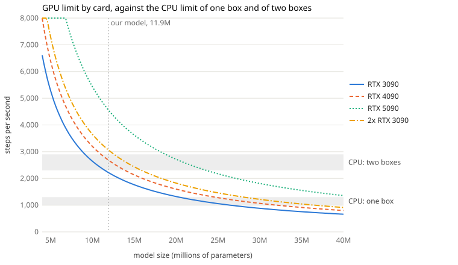
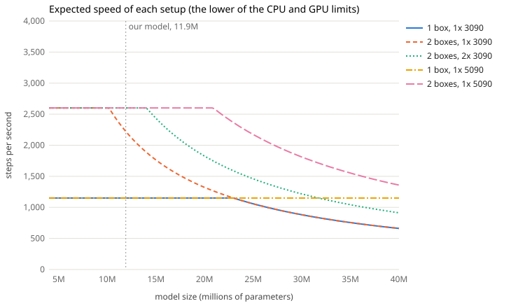

# A home training rig: costs, speeds and limits

Prices checked 2026-10-09/10. GPU and RAM prices are moving week to week; check each link before buying.
Speeds are estimates from our measured numbers (below), not measured on these machines.

## What sets the speed

```
one machine
┌──────────────────────────────────────────────┐
│ CPU: runs the games, each its own program    │
│  [game 1] [game 2] ... [game N]              │  ~0.2 of a core and ~0.3 GB RAM per game
│                                              │
│ GPU: runs the network                        │
│  inference: picks every game's orders        │  124 µs a step on a 3090 (our 11.9M model)
│  learner:   trains on the games' steps       │  326 µs a step on a 3090
└──────────────────────────────────────────────┘
speed = the lower of what the CPU can play and what the GPU can decide and learn from
```

- **CPU:** a game step costs ~10-12 ms of CPU (`docs/training/9-benchmarks.md`), so one core plays ~80-100 steps/s.
  About 3-4 of a box's cores go to inference, the learner and the actors.
- **RAM:** ~0.32 GB per game; ~140 games make ~2,500 steps/s. 64 GB per box is enough for every setup here.
- **GPU:** our training is limited by how fast the card moves data through its memory, not by its math: on an H100 the
  learner's math is ~4% of the card, and most of an update is small operations, copies and attention. So a card's memory
  speed matters more than its math speed.

## The three setups

| | 1 box, 1x 3090 | 2 boxes, 1x 3090 | 2 boxes, 2x 3090 |
|---|---|---|---|
| Cores for games | ~12-13 | ~28-29 | ~28-29 |
| CPU limit | ~1,000-1,300 steps/s | ~2,300-2,900 | ~2,300-2,900 |
| GPU limit (our 11.9M model) | ~2,200 | ~2,200 | ~3,000 (learner card; the inference card is mostly idle) |
| **Expected speed** | **~1,000-1,300** (CPU-bound) | **~2,200** (GPU-bound) | **~2,300-2,900** (CPU-bound) |
| Largest model at full speed | ~23M | ~10M (ours, 11.9M, runs at ~2,200) | ~14M |
| Play per day (250 ms of game time per step) | ~0.8 years | ~1.5 years | ~1.8 years |
| **Cost** | **~$4,400** | **~$6,600** | **~$8,900** |

- Two 3090s split the work the way our cloud runs split two H100s: the learner on GPU 0, inference on GPU 1
  (`training/cloud/selfplay.py:95`). The learner is the larger part (326 vs 124 µs a step), so the split reaches ~3,000
  steps/s, not 2x one card's 2,200. Spreading the learner across both cards would go further; our code doesn't do that.
- For scale: our cloud run does ~7,000 steps/s (~4.8 years of play a day). AlphaStar's January 2019 agents had up to
  ~200 years of play each (~14 a day); OpenAI Five ~180 years a day. At ~1.7 years a day, 200 years takes ~4 months.

## Steps/s against model size



Each card's line is what its GPU can feed at that model size; the gray bands are what the CPUs can play with one box and
with two. Your speed is whichever is lower.

| Card | GPU limit at 11.9M | Largest model at 2,600 steps/s (two boxes' CPU limit) | Memory speed |
|---|---|---|---|
| RTX 3090 | ~2,200 steps/s | ~10M | 936 GB/s |
| RTX 4090 | ~2,700 | ~12M | 1,008 GB/s |
| RTX 5090 | ~4,600 | ~21M | 1,792 GB/s |



With a 5090 instead of the 3090(s): one box stays CPU-bound at ~1,000-1,300 steps/s up to ~47M parameters; two boxes
stay CPU-bound at ~2,300-2,900 up to ~21M (against ~14M for two 3090s and ~10M for one).

How the curves are made (`plots.py`): GPU time per step for our 11.9M model, then scaled in proportion to model size.

1. Math per step: the step transformer (2.62M parameters) over ~118 tokens is ~0.78 GFLOP a forward pass; learning
   (forward, backward, the reference pass) ~3.1 GFLOP. Check: 8,192 steps x 3.1 GFLOP in our H100's 0.62 s update is
   41 TFLOP/s, ~4% of its peak, as our docs say.
2. Split the H100's 0.62 s into math (at 60% of peak: 0.04 s) and the rest (0.58 s, limited by memory speed).
3. On each card: math / its math peak (3090 71, 4090 165, 5090 ~210 TFLOP/s bf16) + the rest x H100's memory speed /
   the card's. Inference the same way from its 1.8 ms per 58 steps.

The biggest assumption is step 3's: that all of the 0.58 s scales with memory speed. If part of it is fixed overhead,
every card does better (up to 2-3x these numbers), and the cards are closer together. **Check before buying:** rent a
3090, a 4090 and a 5090 for an hour each (a few dollars) and run `training/bench/profile_learner.py` and
`training/bench/step_parts.py`.

## What to buy

### Box 1 (GPU, learner, inference, games): ~$4,400

| Part | Price | Where |
|---|---|---|
| CPU: Ryzen 9 9950X (16 cores) | ~$549 | [Amazon](https://www.amazon.com/dp/B0D6NNRBGP) ([price history](https://camelcamelcamel.com/product/B0D6NNRBGP)); B&H $549.99 on Oct 7 |
| Motherboard: X870 | ~$300 | any; for two 3090s, one with two full-length slots ~3 slots apart (x8/x8) |
| RAM: 64 GB desktop DDR5 | ~$850-1,000 | the cheapest in stock first-party on Oct 11: [G.Skill Ripjaws S5 64 GB (2x32) DDR5-5600](https://www.pgrid.app/us/rams/gskill-ripjaws-s5-ddr5-64gb-2x-5600mhz-cl36), $849.99 at Amazon; 64 GB kits were ~$200 in 2025 |
| GPU: RTX 3090 24 GB (out of production: used or renewed) | ~$1,700-2,000 | [Amazon B08NNKHVP3](https://www.amazon.com/dp/B08NNKHVP3) (~$1,715 used, Oct 9); Amazon Renewed, 90-day guarantee: [Founders Edition](https://www.amazon.com/NVIDIA-GeForce-Founders-Graphics-Renewed/dp/B09GWB753L), [MSI Ventus 3X](https://www.amazon.com/MSI-3090-Architecture-3X-24G/dp/B094PSPVPC), [Gigabyte Gaming OC](https://www.amazon.com/Gigabyte-GeForce-Graphics-WINDFORCE-GV-N3090GAMING/dp/B09CN33TJT), [ASUS ROG Strix](https://www.amazon.com/ASUS-Graphics-Axial-tech-Pressure-ROG-STRIX-RTX3090-O24G-GAMING/dp/B09S1CJY5L); [Micro Center refurbished](https://www.microcenter.com/product/677156/nvidia-geforce-rtx-3090-founders-edition-dual-fan-24gb-gddr6x-pcie-40-graphics-card-(refurbished)) (out of stock Oct 10) |
| Cooler | ~$100 | any good air cooler for AM5 |
| Power supply: 1000 W | ~$180 | 1,300-1,600 W for two 3090s (~$350-550) |
| SSD: Samsung 990 Pro 2 TB | ~$390 | Amazon, sold by Amazon (in stock Oct 2) |
| Case | ~$120 | a large one with good airflow for two 3090s |

### Box 2 (games only): ~$2,200

Same CPU, a cheaper motherboard (~$250), 64 GB RAM (~$850), a cooler (~$100), a 650 W power supply (~$150), a 1 TB SSD
(~$200) and a case (~$100). No GPU. An ethernet cable to Box 1 (the two talk over the network, as our cloud games do).

### Second 3090: ~$2,000, plus ~$200-300 for the bigger power supply and case

### Not chosen, for reference

- **One Threadripper box** instead of two Ryzen boxes: the same ~28 cores for games in one machine, but it needs
  registered ECC server RAM, which costs ~2x desktop RAM right now. ~$10,300 with one 3090:
  [Threadripper 9970X at Newegg](https://www.newegg.com/amd-ryzen-threadripper-9970x-ryzen-threadripper-9000-series-shimada-peak-socket-str5-processor/p/N82E16819113915) ($2,404, sold by Newegg),
  [ASUS TRX50-SAGE at Newegg](https://www.newegg.com/asus-pro-ws-trx50-sage-wifi/p/N82E16813119666) ($852),
  [Kingston 128 GB registered kit at Micro Center](https://www.microcenter.com/product/696279/kingston-fury-renegade-pro-128gb-(4-x-32gb)-ddr5-5600-pc5-44800-cl28-quad-channel-ecc-registered-memory-modules-kf556r28rbe2k4-128-black) ($4,000, in store).
  Intel's Xeon W has the same RAM problem and is usually slower per core.
- **RTX 4090:** ~$4,500 on Amazon for ~20% more GPU than a 3090 (its memory speed is about the same).
- **RTX 5090:** no retailer had one in stock at its own price on Oct 10; Best Buy's marketplace sellers asked
  $8,045-9,080. At that price two 3090s (~$4,000) match it once the CPUs are the limit.
- **Windows instead of Wine:** the games skip Wine's ~20% CPU overhead (maybe 20-30% more games per core, unmeasured),
  with the learner and inference in WSL2 as Robin does. Windows 11 Pro ~$200 per box.

## Getting a 5090 at retail price

The Founders Edition's list price is $1,999 (sold in the US by Best Buy and NVIDIA's own store); partner cards from
retailers run ~$2,400-3,500. Restocks sell out in minutes: an MSI 5090 at Amazon for $3,059.99 lasted 5 minutes on Oct 9.

NowInStock's log for Sep 9 - Oct 9: 54 in-stock events (~2 a day), almost all at $4,400-5,300 (ASUS Shop 27, B&H 13,
Amazon 8, Newegg 4, Walmart 2). Under $4,000 only three times: Amazon $3,059.99 (Oct 9) and Walmart $3,999.99 (Sep 21,
Oct 4), each gone in ~5 minutes. No Founders Edition ($1,999) restock in that month.

1. **Alerts:** [NowInStock's 5090 tracker](https://www.nowinstock.net/computers/videocards/nvidia/rtx5090/) sends free
   email, text or app alerts per retailer (Amazon, Best Buy, Newegg, B&H, Walmart, NVIDIA). Turn on app push alerts:
   email is too slow.
2. **Be ready before the alert:** signed in at Best Buy, Amazon and Newegg, with payment and address saved, so checkout
   is one click.
3. **Best Buy Founders Edition drops:** add the [Founders Edition page](https://www.bestbuy.com/product/nvidia-geforce-rtx-5090-founders-edition-32gb-gddr7-pci-express-5-0-graphics-card-dark-gun-metal/J3GWYHGPCP) to your saved items and follow its stock.
   NVIDIA's own store has a "Notify me" button on its 5090 page.
4. **Micro Center:** in-store stock shows on its site per store; it often gets cards that never reach online stores.
5. **Only buy first-party:** check "Sold and shipped by Best Buy / Amazon.com / Newegg / B&H". Best Buy and Newegg
   list marketplace sellers on the same pages ($8,000+ on Oct 10).
